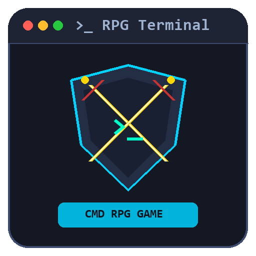

# RPG Terminal - MediaHub Edition ⚔️



**RPG Terminal** es un videojuego de combate por turnos estilo RPG clásico para la consola CMD/Terminal, integrado oficialmente en el conglomerado **MediaHub**.

Incluye soporte para renderizado enriquecido con **Rich**, efectos de sonido y voces retro con **PyGame / Winsound**, sistema de tienda, mochila, combos, ataques especiales y más de 10 personajes icónicos.

---

## 🎮 Características

* **Combate por Turnos Dinámico**: Atacar, combos especiales, ultimates, esquivar y descansar.
* **Inteligencia Artificial Equilibrada**: Toma de decisiones del oponente según recursos de estamina, con fallbacks automáticos sin bloqueos.
* **10+ Personajes Jugables**:
  * **Naruto Saga**: Naruto, Sasuke
  * **Dragon Ball Z**: Goku, Vegeta
  * **Bleach**: Ichigo, Aizen
  * **The King of Fighters**: Kyo, Iori
  * **Genshin Impact**: Kazuha, Alhacen
* **Efectos de Audio y Voces**: Reproducción asíncrona de efectos de sonido FX y diálogos para cada personaje.
* **Economía y Gestión**: Tienda de ítems, pociones (B, A, S, SS) y mochila de inventario.
* **Integración MediaHub**: Totalmente compatible con **MediaHub Launcher** para instalación y ejecución con un clic.

---

## 🚀 Requisitos e Instalación

### Requisitos
* Python 3.10 o superior (recomendado Python 3.11/3.13)
* Windows (Terminal de Windows o CMD con codificación UTF-8)

### Instalación de dependencias
```bash
python -m pip install --upgrade pip
pip install -r requirements.txt
```

### Ejecutar en desarrollo
```bash
python main.py
```

---

## 📦 Compilación para Distribución

Para generar el ejecutable compatible con el catálogo de **MediaHub**:

```bash
pyinstaller RPGTerminal.spec
```

El ejecutable `RPGTerminal.exe` se generará en `dist/RPGTerminal/RPGTerminal.exe`.

Para empaquetar la versión oficial:
```powershell
Compress-Archive -Path "dist\RPGTerminal\*" -DestinationPath "MediaHub-RPGTerminal.zip" -Force
```

---

## 📂 Estructura del Proyecto

```
RPGTerminal/
├── .github/
│   └── workflows/
│       └── build.yml               # Pipeline CI/CD de compilación y releases
├── assets/
│   └── hub/
│       ├── Media-Hub.ico           # Icono oficial MediaHub
│       └── rpgterminal.png         # Logo y carátula para el Launcher
├── TerminalGameClient/
│   ├── assets/
│   │   └── SFX/                    # Efectos de sonido y voces
│   ├── configs/                    # Configuraciones
│   ├── scripts/                    # Scripts auxiliares
│   ├── src/
│   │   ├── characters/             # Modelos de personajes y oponente
│   │   ├── core/                   # Lógica de juego, eventos y sonido
│   │   ├── ui/                     # Vistas y pantallas en consola
│   │   └── utils/                  # Utilidades, consola Rich y manejo de errores
│   └── tests/
│       └── test_combat.py          # Pruebas automatizadas de combate
├── .gitignore                      # Exclusiones de control de versiones
├── main.py                         # Punto de entrada raíz de la aplicación
├── requirements.txt                # Dependencias del proyecto
├── RPGTerminal.spec                # Especificación PyInstaller
└── README.md                       # Documentación
```

---

## ⚖️ Licencia
Desarrollado para el ecosistema **MediaHub**.
